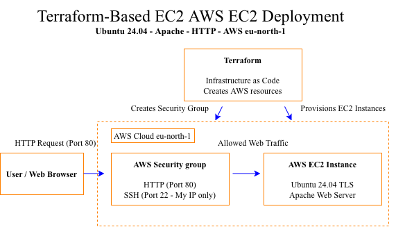

# AWS EC2 Web Server Deployment with Terraform

## Overview

This project provisions an AWS EC2 web server using Terraform and deploys a simple website using Ubuntu and Apache HTTP Server.

It demonstrates infrastructure as code (IaC), AWS networking, Linux administration, web server deployment, and Git-based version control.

## Architecture

- **Cloud provider:** AWS
- **Infrastructure as code:** Terraform
- **Compute:** Amazon EC2 (`t3.micro`)
- **Operating system:** Ubuntu Server 24.04 LTS
- **Web server:** Apache HTTP Server
- **Networking:** VPC, public subnet, Internet Gateway, route table, and security group
- **Storage:** 8 GB encrypted gp3 EBS root volume
- **Version control:** Git and GitHub

## Features

- Provisions an EC2 instance and security group using Terraform.
- Configures HTTP access on port 80.
- Restricts SSH access on port 22 to a specified public IP address.
- Deploys a custom HTML page using Apache.
- Uses Terraform outputs to display the instance ID, public IP, and security group ID.
- Excludes private keys and Terraform state files through `.gitignore`.

## Deployment Steps

1. Configure AWS CLI credentials with appropriately scoped IAM permissions.
2. Install Terraform and Git.
3. Configure the AWS provider, security group, and EC2 instance in `main.tf`.
4. Run `terraform init`.
5. Run `terraform fmt` and `terraform validate`.
6. Review the infrastructure changes with `terraform plan`.
7. Run `terraform apply` to provision the infrastructure.
8. Connect to the Ubuntu instance using SSH.
9. Install Apache and deploy the website to `/var/www/html/index.html`.
10. Use `terraform output` to retrieve infrastructure details.

## Security Considerations

- SSH access should be restricted to trusted IP addresses.
- Private SSH keys and Terraform state files must not be committed to Git.
- AWS credentials should be managed securely and never hardcoded in Terraform files.
- HTTPS requires a separate TLS certificate and server configuration.

## Troubleshooting Experience

During deployment, SSH connectivity failed because the VPC's default route referenced a detached Internet Gateway. The route was restored by attaching the existing Internet Gateway to the VPC, after which SSH connectivity worked.

## Cleanup

When the environment is no longer needed, review the resources and use `terraform destroy` from the correct project directory to remove Terraform-managed resources. Confirm the plan before approving the deletion.

## Repository

[View the project on GitHub](https://github.com/UmarArshad3/terraform-aws-ec2-deployment)

*This is a learning and portfolio project. Resource availability, AWS charges, and configuration requirements may vary by account and region.*
## Architecture

The infrastructure is provisioned using Terraform. An AWS EC2 instance runs Ubuntu 24.04 with Apache, while a security group controls inbound HTTP and SSH access.

